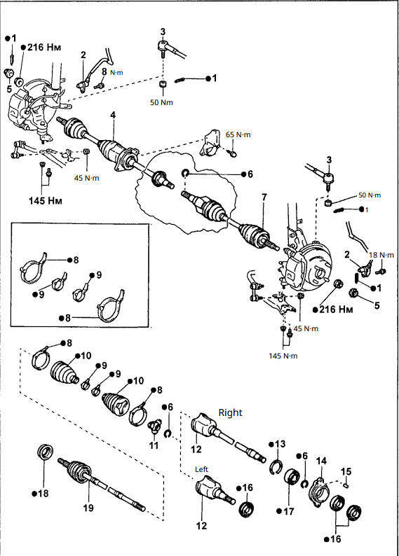

## videos
https://www.youtube.com/watch?v=R-9Kj_FkCDQ (I think this is ai??)
https://www.youtube.com/watch?v=a4zkky80luQ
https://www.youtube.com/watch?v=YH5Cf7uJV5Y the goat
https://www.youtube.com/watch?v=hQJ2LEOW7Mg
Always do both inner and outer boots
https://www.youtube.com/watch?v=xuxXjTZ7Nms - toyota dealership I think?
https://partsouq.com/en/catalog/toyota/diagram/JP/1996/SPRINTER-CARIB/AE115G-CWPGK/catalog/157120/category/2/diagram/4302/illustration/430113C

Split boot repair where you heat a split boot. Seems easier but more prone to breaking
https://www.youtube.com/watch?v=Os5-gTjRm44
Video showing it after use https://www.youtube.com/watch?v=hGE2FOpfWlw
https://www.youtube.com/watch?v=MCj-dBwuecQ
https://www.youtube.com/watch?v=MCj-dBwuecQ

Transmission fluid: Dexron 3
## torque specs
torque spec of axle nut: 216 Nm - 160 ft lbs
bolts for the lower sus arm : 145 Nm - 107 ft lbs

04438-12305 - left side
04438-20136 -  right side

## Interesting notes
- The upper CV axle was already replaced with a split one, that looked like it was about to fall apart, definitely not seated correctly
- A lot more transmission fluid came out than I thought.

## What went well
- Using a slide hammer and straps to remove the axle
- Removing the whole axle made it much easier to work on
- removing the hub nut when both wheels were on the ground
- just removing the 3 bolts attached to the lower suspension linkage gave me plenty of space. Then using a tie down strap to keep it out of the workspace
- catch can to catch all the transmission fluid

## What I wished I did differently
 - Being more careful to take not of the exact orientation of the spider bearing and the inner cv axel part that went over the spider bearing, so I could re insert it the exact way it came out, so the wear pattern stays the same.
	 - Next time, I should mark position of spider bearing on the axel before I take it off, and mark what channel each bearing went into before re inserting it
 - The spring came out of the transmission seal, signaling it should probably be changed too, I should pay attention to any transmission fluid leaking out of the seal
 - being more mindful to reinsert the axel with the c clamp on the end facing down.
 - Take more pictures before I remove anything
 - Generally slow down more