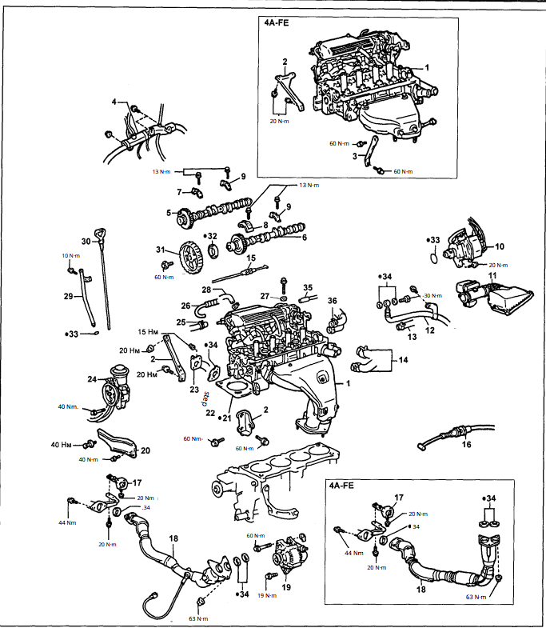

https://www.youtube.com/watch?v=a99047Jfs8M
https://www.youtube.com/watch?v=j1OtI-8k9Ns
https://www.youtube.com/watch?v=Uk7l7DrvLOM
tip so I don't need to reattach the spring (step at 11:58 in [this video](https://www.youtube.com/watch?v=j1OtI-8k9Ns)): https://www.youtube.com/watch?v=911Rm7GDorE
Thought:
I should count the teeth between each of the components on the timing belt before I take it off.
Also should check slack before
Find way to mark where the bolts are on the accessory belts prior to removing so I know correct tension

accessory belt: https://www.youtube.com/watch?v=kacsKy5iD24

 https://charm.li/Toyota/1996/Corolla%20Wagon%20L4-107.5%201762cc%201.8L%20DOHC%20%287A-FE%29/Repair%20and%20Diagnosis/Maintenance/Timing%20Belt/Service%20and%20Repair/Timing%20Belt%20Removal/

timing belt: [13568-19056](https://autoparts.beavertontoyota.com/products/product/belt-timing-1356819056?_br_psugg_q=1356819056&siteid=sem_tpco_36047_google_searchoptics_shopping_beavertontoyota) 43.12

Tools
25mm wrench for the camshaft
Seal removers

From outside -> inside
- Alternator Belt - 99365-20970
- AC belt - 99364-20850
- Power steering pump belt - 99363-80630

jp-carparts
BELT, V (FOR FAN & ALTERNATOR) - 	99365-20970
BELT, V (FOR VANE PUMP) - 99363-80630
BELT, V (COOLER COMPRESSOR TO CRANKSHAFT PULLEY) - 99364-20850

Water pump - 16100-19265

GASKET, CYLINDER HEAD COVER - 1121315071 
OIL SEAL, FRONT DRIVE SHAFT, LH - 9031135040 

GASKET, WATER PUMP COVER - 1612416060 
SEAL, ENGINE REAR OIL - 90311-70007

Bolts:
crank bolt: **9011912314**
camshaft bolt: 9011910380

AL- Alternator
CC - cooler compressor
CK - crank shaft
IP - idle pulley
VP - Vane Pump
WP - Water Pump

timing belt and cam shaft
Timing belt cover

Alternator

Water Pump

