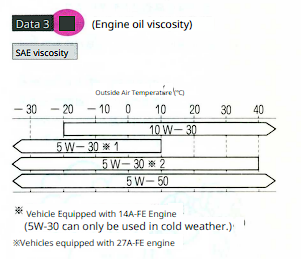
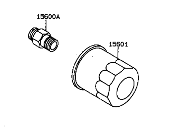

Oil capacity

SAE 5W-50

Looks like 10W-30 or 5W-30 is what I should actually be using. **The first number ("5W" or "10W")** = winter/cold viscosity, Lower number = oil flows more easily when cold

Motul recommended from [Popeye Article]
[buy link](https://www.importimageracing.com/products/motul-asian-import-motor-oil-5w-30-5-liter?currency=USD&country=US&variant=42595809919072&utm_source=google&utm_medium=cpc&utm_campaign=Google%20Shopping&stkn=d776b209dbda&gad_source=4&gad_campaignid=21813107490&gbraid=0AAAAAD-oGOBdFKR9nX4HyJ6KU5T6Kg_VR&gclid=CjwKCAjw3ejRBhAdEiwADkqPn2xdetdV1Q-ElHuQgAzK7Ud7AV35xD7ux3VINrI-WHiNn-BOWN6ohhoCYFIQAvD_BwE)
Oil filter: 

[tutorial](https://www.youtube.com/watch?v=ltd4-8XxsXA)
