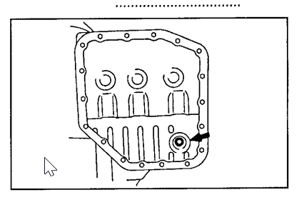
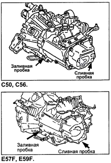
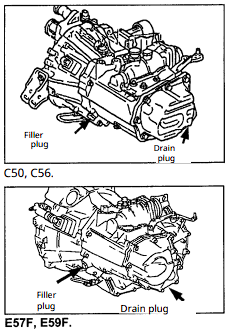

Dexron 3
00718-ATF00
probably best to use only toyota atf.
refilling the transmission fluid: Page 26. of[ the manual](file:///S:/Car%20Stuff/Toyota_SPRINTER_CARIB_1995-2001_autorepman.com-en_mono_doclingo.ai.pdf)
removal/reinstallation of front drive shaft: [page 149 of manual](file:///S:/Car%20Stuff/Toyota_SPRINTER_CARIB_1995-2001_autorepman.com-en_mono_doclingo.ai.pdf)

when I removed the CV boot, about 1.5L of transmission fluid came out. I then drove a total of about 15 miles, which seems really bad. The dipstick was reading so low, that I though there was a problem with the dipstick. This is probably my worst mistake I've made, and I probably did cause some amount of damage to the transmission. I am very embarrassed, like yea, 1.5L coming out probably means I need to put 1.5 liters back in. In fact, step 5 of removing the front drive axle is "Drain the oil from the gearbox (transfer case)". I think that I did this because in watching the tutorials on the cv axle removal, they did not talk about this step.

It looks like the volume of a "dry" gearbox is 7.6-8.2 L, so 1.5 L out is not insignificant.
Also, that means that to refill it, it would probably be over 100$, which I may want to consider as well.

