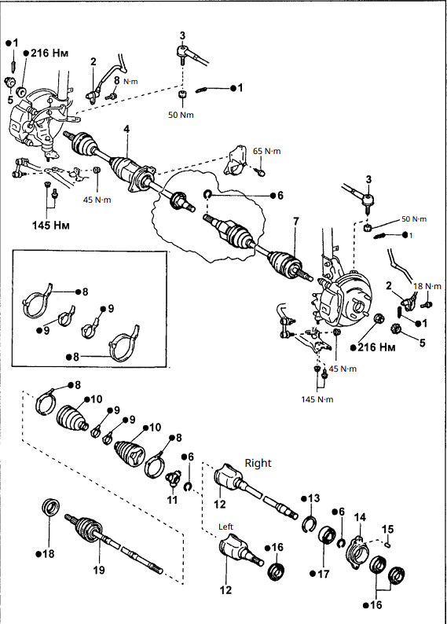

## videos
https://www.youtube.com/watch?v=R-9Kj_FkCDQ (I think this is ai??)
https://www.youtube.com/watch?v=a4zkky80luQ
https://www.youtube.com/watch?v=YH5Cf7uJV5Y the goat
https://www.youtube.com/watch?v=hQJ2LEOW7Mg
Always do both inner and outer boots
https://www.youtube.com/watch?v=xuxXjTZ7Nms - toyota dealership I think?
https://partsouq.com/en/catalog/toyota/diagram/JP/1996/SPRINTER-CARIB/AE115G-CWPGK/catalog/157120/category/2/diagram/4302/illustration/430113C

Split boot repair where you heat a split boot. Seems easier but more prone to breaking
https://www.youtube.com/watch?v=Os5-gTjRm44
Video showing it after use https://www.youtube.com/watch?v=hGE2FOpfWlw
https://www.youtube.com/watch?v=MCj-dBwuecQ
https://www.youtube.com/watch?v=MCj-dBwuecQ

## torque specs
torque spec of axle nut: 216 Nm
bolts for the lower sus arm : 145 Nm

04438-12305 - left side
04438-20136 -  right side

